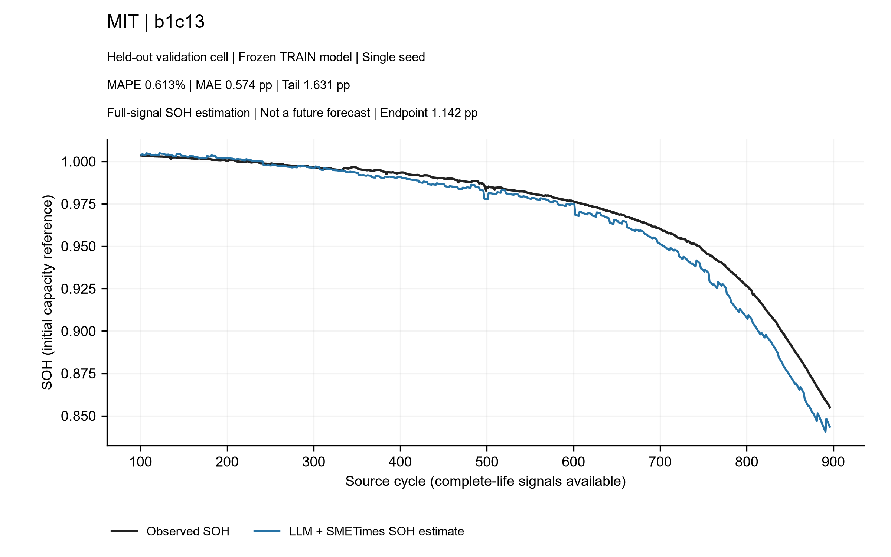

# LLM + SMETimes：完整信号 SOH 估计 v0.1

这是已训练模型的独立项目入口：输入某颗电芯整个寿命阶段的可用电压、电流、温度等信号特征，估计同一时段 SOH。主干为冻结的 Llama-3.2-1B-Instruct，可训练部分包含数值输入投影、融合、SMETimes 专家和共享 SOH 重建头。

**这是完整信号、同一时段的 SOH 估计模型，允许读取目标时段附近的信号；不属于严格因果在线估计，也不支持仅前100周期预测整个未来寿命。** 当前是单种子研究 MVP，不是部署就绪模型。五颗未训练电芯的结果不能代表整个验证集或测试集。

## 已完成结果

240颗 TRAIN 电芯全部参加完整寿命重建监督；各数据集独立训练。SOH 标签用于损失，不作为模型输入；未使用容量字段、真实寿命或电芯 ID 查表。模型选择仅按 TRAIN 宏平均 MAE。各数据集均为固定首折、种子20260930。

| 数据集 | TRAIN 电芯数 | TRAIN 平均 MAPE | 未训练验证电芯 | 完整信号估计 MAPE | 未经预测训练的前100直接外推 MAPE |
|---|---:|---:|---|---:|---:|
| MIT | 83 | 0.329% | b1c13 | 0.613% | 2.838% |
| XJTU | 31 | 0.684% | b1_2C_battery-1 | 0.789% | 5.346% |
| HUST | 45 | 0.263% | HUST_1-1 | 1.267% | 13.012% |
| UConn_ISU_ILCC | 42 | 0.279% | UConn_LFP_003 | 1.174% | 3.958% |
| Zhu2022_NCA | 39 | 0.565% | CY45-05_1-#3 | 0.641% | 1.336% |

每个数据集提前固定选取 frozen validation 列表的第一颗电芯，未按效果挑选、未重新训练、未改权重。两种推理都仅在原始 source cycle>100 的真实 SOH 标签上计算指标。前100外推只是把重建头在最后观测的潜特征上直接查询未来周期，并非已训练的预测模型，不能用于判定经过专门训练的未来预测方案是否有效。

UConn 前100周期只有cycle 0的一次信号记录。MIT 前100外推虽然 MAPE<3%，终点误差仍达13.893个百分点且漏掉拐点；不能单凭平均误差认定曲线达标。XJTU TRAIN 中仍有7颗电芯终点误差>3个百分点。

- [全部逐电芯 TRAIN 指标](TRAIN_cell_metrics.csv)
- [机器可读的汇总指标](results.json)
- [权重和全部 PDF 图集 Release](https://github.com/lucassete10-dot/LLM-SMETimes/releases/tag/full-signal-soh-v0.1)
- [MIT 完整信号曲线](examples/MIT/full_signal.png) / [前100外推对照](examples/MIT/prefix_only.png)
- [XJTU 完整信号曲线](examples/XJTU/full_signal.png) / [前100外推对照](examples/XJTU/prefix_only.png)
- [HUST 完整信号曲线](examples/HUST/full_signal.png) / [前100外推对照](examples/HUST/prefix_only.png)
- [UConn 完整信号曲线](examples/UConn_ISU_ILCC/full_signal.png) / [前100外推对照](examples/UConn_ISU_ILCC/prefix_only.png)
- [NCA 完整信号曲线](examples/Zhu2022_NCA/full_signal.png) / [前100外推对照](examples/Zhu2022_NCA/prefix_only.png)



## 下载与推理

从仓库根目录运行。适配权重与 TRAIN 标准化参数由 Release 中的 `full_signal_soh_estimators_v0.1.zip` 提供，解压后有 `estimators/<dataset>/model.pt` 和 `estimator.json`。无需重新训练。

适配包不包含预训练 LLM，也不包含原始数据。请自行按许可取得 `meta-llama/Llama-3.2-1B-Instruct`。程序核对主干、tokenizer、适配权重的 SHA256；需要与原实验完全相同的模型文件。五个适配器不能跨数据集交换。

运行环境沿用仓库 [requirements.txt](../../requirements.txt)，需另安装 `joblib`（已有 sklearn 依赖）、`pymupdf`（仅原研究图集工具使用）。本次验证环境是 Python3.12、CUDA GPU、torch2.9.1+cu128。当前推理实现需要 CUDA；不宣称支持 CPU。

```powershell
python -m scripts.infer_full_signal_soh --help
python -m scripts.infer_full_signal_soh --bundle downloaded/estimators/MIT --checkpoint models/llm/llama-3.2-1b-instruct --signals my_signals.npz --out outputs/MIT_soh.csv
```

输入 NPZ 必须包含以下字段，不需要 SOH、容量、寿命或电芯 ID：

| 字段 | 内容 |
|---|---|
| `cycle` | N个实际源周期，严格递增的有限数值 |
| `raw` | N×D原始信号特征矩阵，允许 NaN 缺失，不允许无穷大 |
| `query_cycle`（可选） | 需要估计 SOH 的实际源周期；缺省为 `cycle` |

查询只能在已输入信号周期范围内。程序明确拒绝未来周期预测。D分别为MIT51、XJTU46、HUST32、UConn606、NCA32；**维数相同并不代表特征相同，顺序、单位、提取窗口必须与训练一致**。不要把原始逐采样点波形直接塞进 `raw`。

特征提取定义见 [完整信号准备器](../../scripts/prepare_llm_full_life.py) 及其调用的 MIT/XJTU/HUST/UConn/NCA 准备函数；各适配包的 `estimator.json` 给出数据集、通道布局、缺失值填补和 TRAIN 标准化参数。数据来源与准备说明沿用仓库现有文档及准备器引用的公开发布源。获取原始数据时遵守其许可，不把本项目源码许可视为第三方数据或 Llama 许可。

JSON 标准化参数在五个验证电芯上与原 sklearn 处理器逐值核对。输出 CSV 为 `source_cycle,estimated_soh`；不包含标签，也不进行曲线平滑、终点校准或人工修图。

## 实现与训练入口

- [模型和训练输入](../../battery_smetimes/llm_reconstruction.py)
- [预训练 LLM 与专家编码](../../battery_smetimes/research_llm.py)
- [TRAIN 训练器](../../scripts/train_llm_reconstruction.py)
- [共享重建头细化](../../scripts/refine_llm_reconstruction.py)
- [便携推理入口](../../scripts/infer_full_signal_soh.py)
- [导出适配器与结果](../../scripts/package_full_signal_soh.py)
- [未训练电芯 MVP](../../scripts/predict_llm_reconstruction_mvp.py)
- [数据与标签隔离测试](../../tests/test_llm_reconstruction.py)

每个数据集先12轮联合学习数值投影、融合、专家与重建头；再固定编码器，最多200轮优化共享头。对优先优化的数据集，再做最多80步全量 L-BFGS，按 TRAIN MAE决定采用哪个版本。没有训练逐电芯自由参数。

原研究队列、审计、图集命令依赖原始数据、冻结划分、预处理缓存及原工作区的绘图 QA 工具；它们是可追溯研究源码，不是下载仓库后即可无数据重跑的命令。上述便携推理入口无需这些实验缓存或绘图技能。重新训练仍需先准备原数据与冻结划分；不能把一个适配包当成全套训练数据。

## 下一阶段：未来特征 → SOH

预测任务的最新输入约定：前100个实际源周期内的SOH也已知，应与同期电压、电流、温度等信号共同作为历史输入。直接使用真实历史SOH确定当前水平、历史下降速度和曲率，并以最后一个实际可见SOH点锚定未来曲线。缺少SOH测量的周期保留观测掩码，不伪造测量点；“前100周期”不等于100个SOH标签。所有输入SOH必须满足实际source cycle≤100，未来SOH仅用于TRAIN监督及隔离的评估。

这一输入约定用于下一阶段的预测模型；本次发布的完整信号估计器仍是信号到同期SOH，不接收历史SOH，不能仅把SOH拼进现有raw矩阵而不重新训练。

可在 LLM+SMETimes 内增加未来退化特征或潜状态预测头，再接现有 SOH 解码器。优先预测有退化信息的压缩特征，不要求逐点还原完整波形。未来工况已知时作为条件输入；未知时只能在明确的工况假设下预测，不能把操作者决定的未来电流当成必然可推断的老化特征。

只在 TRAIN 电芯上构造多个历史截点的“过去信号→未来特征、未来SOH”监督，保留现有编码器初始化，并与直接预测SOH的同输入基线对照。需要检查未来特征误差、SOH误差、尾段与拐点、误差累积。此阶段尚未实现或验证；本次五颗电芯已查看，属于开发样本，不能再称盲测。

相关方法参考：[World Model for Battery Degradation Prediction Under Non-Stationary Aging](https://arxiv.org/abs/2603.10527) 将周期信号编码成潜状态，再学习状态转移与未来SOH。它是研究参考，未被复制到当前实现，也不构成对本模型效果的证明。
